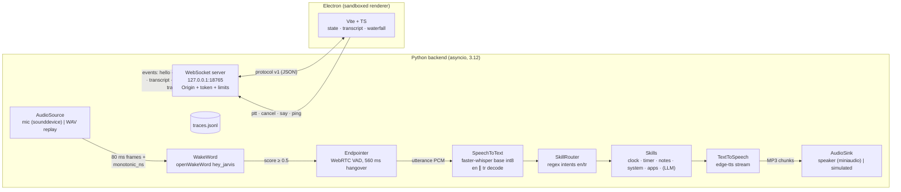
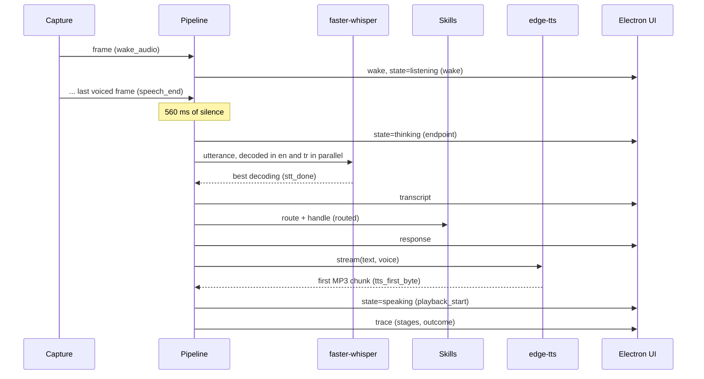

# GIDEON

[](https://github.com/hekimcan206/gideon/actions/workflows/ci.yml)
[](https://github.com/hekimcan206/gideon/actions/workflows/codeql.yml)


[](LICENSE)

GIDEON is a **voice desktop assistant** that understands English and Turkish (my graduation project, rebuilt and
measured). A Python asyncio backend runs the speech pipeline: wake word ([openWakeWord](https://github.com/dscripka/openWakeWord)),
end-of-utterance detection, speech-to-text ([faster-whisper](https://github.com/SYSTRAN/faster-whisper), CPU int8),
skills and streaming text-to-speech ([edge-tts](https://github.com/rany2/edge-tts)). An Electron + TypeScript UI
follows it in real time over a versioned WebSocket protocol and shows the assistant's state, the transcript and a
**per-stage latency waterfall** for every interaction.


> The screenshot is the real stack from `docker compose up`. Synthetic utterances generated with edge-tts are replayed
> in real time through the real wake-word, VAD and Whisper models. No microphone is involved and no real person's
> voice is used.

## Problem

A voice assistant is a latency budget with a UI attached. From the moment the user stops talking, every stage adds
time the user notices: deciding that the sentence is over, transcribing it, working out what was meant, starting to
speak. A demo that "works" tells you nothing about where those seconds go. On top of that:

- **The wake word must be cheap and always on.** It runs every 80 ms, forever, and must not wake on everything.
- **Short commands defeat language detection.** Whisper labelled "Saat kaç?" ("what time is it?") as Romanian and
  "Notlarımı oku" ("read my notes") as Portuguese.
- **The UI and the audio loop must not stall each other**, and the UI must survive the backend restarting.
- **An assistant that runs programs is an attack surface.** That includes a misheard command, a web page talking to
  the local socket, and the Electron renderer itself.

## Solution

| Concern | How | Where |
|---|---|---|
| Explicit pipeline | capture → wake word → end-of-utterance → STT → intent/skill → TTS → playback. Each stage sits behind a `Protocol`, so CI runs the whole pipeline with fakes | `gideon/audio/interfaces.py`, `gideon/pipeline.py` |
| Measured latency | every event carries a `monotonic_ns` timestamp; stages are the gaps between consecutive marks, so the waterfall always adds up; JSONL trace per interaction; median/p95 benchmark tools | `gideon/latency.py`, `gideon/bench.py` |
| Barge-in | capture never blocks on a response; a wake word (or Stop) cancels the response task and playback stops within one chunk | [ADR 0003](docs/adr/0003-streaming-tts-and-barge-in.md) |
| Bilingual STT | the utterance is decoded in English and Turkish in parallel; the decoding with the higher mean log-probability wins; each decode is primed with the skills' example phrases | [ADR 0002](docs/adr/0002-stt-model-choice-int8-and-bilingual-decoding.md) |
| End of speech | WebRTC VAD on 20 ms sub-frames, a 560 ms hangover, start/no-speech/max-length rules, unit-tested frame by frame | [ADR 0004](docs/adr/0004-end-of-utterance-policy.md) |
| Skills | time/date, timers (spoken when they ring), system info, allow-listed app launcher, notes, help; Turkish-aware normalisation (İ/ı, diacritics folding); optional LLM fallback (Ollama, off by default) | `gideon/skills/` |
| Process split | Python owns audio and models; Electron is a client. Pydantic protocol → JSON Schema → generated TypeScript types, with a CI drift check | [ADR 0001](docs/adr/0001-python-backend-electron-ui-over-websocket.md) |
| Security | loopback bind, Origin allow-list before the upgrade, per-launch token, frame limits, no shell for app launches, sandboxed renderer with strict CSP | [threat model](docs/threat-model.md) |

## Architecture



One interaction, with the timestamps the trace records:



## Why this design

- **Batch STT after the endpoint, not streaming partials.** Whisper pads every input to a 30 s window, so
  re-decoding a growing buffer multiplies the cost. Commands are 1 to 3 s long. One decode after the endpoint is
  faster end to end on a CPU ([ADR 0002](docs/adr/0002-stt-model-choice-int8-and-bilingual-decoding.md)).
- **Parallel bilingual decoding instead of language ID.** Detection costs a full encoder pass and was wrong on half
  of the Turkish clips. Two decodes on separate CTranslate2 workers cost about one decode of wall time on a multi-core
  CPU, and they were right on every fixture.
- **Regex intents, not a model.** The intents are deterministic, explainable in a log line, covered by golden tests
  with real Whisper spellings, and take microseconds on the critical path. An LLM is an opt-in fallback for what no
  skill matches.
- **Stages measured as gaps between marks.** The waterfall can never disagree with the end-to-end number, and the
  WAV source releases audio on the capture schedule, so simulated numbers mean the same thing as live ones.
- **The UI is just another client.** The same renderer bundle runs in Electron (`app://`), in a browser (compose
  demo) and under Playwright. The backend restarts without the UI noticing more than a reconnect.

## Quick start

### Demo without a microphone (Docker)

```bash
docker compose up --build
# open http://localhost:18766
```

The `fixtures` service synthesises nine English/Turkish utterances ("Hey Jarvis … what time is it?", "… saat kaç?",
"… beş dakikalık zamanlayıcı kur" …) with edge-tts. The backend replays them in a loop in real time through the real
models, speaks the answers with edge-tts into a simulated speaker, and writes traces to the `data` volume. It needs
internet access for edge-tts. Set `GIDEON_TTS=simulated` to answer offline once the fixtures exist.

### Desktop app on real hardware

```powershell
scripts\install.ps1        # Windows: venv, engines, models, UI build (needs Python 3.12/3.13 and Node 22.12+)
scripts\start.ps1          # Electron starts the backend with a random per-launch token
```

```bash
scripts/install.sh && scripts/start.sh     # Linux/macOS (Linux live mode needs libportaudio2)
```

Say **"Hey Jarvis"**, wait for the orb to turn green, then a command. Space = push to talk, Esc = stop, or type a
command. Useful settings (environment variables): `GIDEON_STT_MODEL` (`tiny`, `base`, `small`),
`GIDEON_STT_LANGUAGE=tr` (monolingual, one decode), `GIDEON_ENDPOINT_SILENCE_MS`, `GIDEON_WAKE_THRESHOLD`,
`GIDEON_LLM=ollama`, `GIDEON_APPS_FILE` (your own allow-list). See `backend/src/gideon/config.py`.

### Development

```bash
cd backend && pip install -e ".[dev]" && pytest -m "not engines"   # unit tests with fakes
python -m gideon fixtures && pytest -m engines                     # real engines on the synthetic WAVs
python -m gideon bench --runs 10                                   # per-stage latency, median/p95
cd ../ui && npm ci && npm test && npm run dev                      # renderer in the browser on :5173
```

## Results (measured)

Measured on a laptop (i7-13620H, Docker Desktop on Windows 11), using the real engines and real-time WAV replay.
Each figure covers 90 utterances (10 rounds × 9 fixtures). Medians and nearest-rank p95 are taken over the 83
interactions that finished. The other 7 hit a DNS outage on the home network during the last round, so edge-tts
could not resolve its host. Method, environment and every raw number: [docs/benchmarks.md](docs/benchmarks.md).

| stage | median ms | p95 ms |
|---|---:|---:|
| wake_detect (openWakeWord, per frame) | 2.5 | 4.9 |
| endpoint (560 ms silence hangover) | 562.8 | 565.2 |
| stt (faster-whisper base int8, en ∥ tr) | 1085.7 | 1876.4 |
| route (intent + skill) | 0.2 | 0.5 |
| tts_first_byte (edge-tts, online) | 1159.5 | 2580.2 |
| playback_start (simulated speaker) | 0.0 | 0.0 |
| **speech end → first audio** | **3038.8** | **4652.7** |

- Wake word detected 90/90, intent correct 90/90, language correct 90/90.
- Speech-to-text, on the 45 utterances of the STT matrix: `tiny` takes 619 ms median but gets 40/45 intents right;
  `base` takes 932 ms and gets 45/45. Without the vocabulary prompt, `base` drops to 40/45. If the language is
  known in advance (a single decode), `base` takes 547 ms, so bilingual decoding costs about 400 ms.
- The benchmark exposed an endpointing bug: the tail of "Jarvis" started the utterance, and the pause before a
  softly spoken command ended it. Before the fix, 5/90 interactions produced an empty transcript; after it, 0/90
  (`fix(endpoint)`, 240 ms start grace).

## Tests

| Suite | What it proves | Count |
|---|---|---|
| Backend unit (pytest, fakes) | protocol validation and schema drift; latency accounting (nearest-rank p95, ordering errors); full state-machine table; endpointer frame by frame; 29 golden bilingual intents; skills (timers ring, notes, allow-list never executes transcript text); pipeline happy path, no-speech, STT failure recovery, barge-in, cancel, typed commands, notifications; WebSocket handshake, Origin rejection (403), token (4401), version (4426), frame limit (1009), broadcast | 143 |
| Backend integration (real engines) | 9/9 fixtures: wake word fires, the expected skill and intent are reached, the language is right, traces are complete and ordered, the endpoint stays within 480–800 ms; edge-tts streams in chunks | 5 (over 9 fixtures) |
| UI unit (Vitest) | back-off curve and jitter; reconnect/reset/fatal-close behaviour, heartbeat drops a half-open socket; reducer; waterfall layout; untrusted text is never parsed as HTML | 35 |
| End to end (Playwright) | compose stack in a real browser: live connection, voice interactions with a 7-stage waterfall, a typed command, CSP present, no console errors | 1 (CI) |

## Limitations and next steps

- **Live-microphone numbers depend on the hardware.** The microphone source and speaker sink are implemented
  (sounddevice capture, streaming miniaudio MP3 playback), but this repository's numbers come from the WAV replay,
  which follows the capture schedule. Microphone buffering and output-device latency add to `wake_detect` and
  `playback_start` on a real machine.
- **Wake word "Hey Jarvis", not "Hey Gideon".** openWakeWord ships pre-trained models only for a few phrases.
  Training a custom "hey gideon" model (openWakeWord's synthetic-data training notebook) is the next step. The
  pipeline only sees a `WakeWordDetector`.
- **The false-accept rate was not measured.** That needs hours of real background audio (TV, conversation). The
  0.5 threshold is openWakeWord's documented default, and the refractory period stops double triggers.
- **The STT vocabulary prompt overlaps the test phrases.** The skills' example phrases prime Whisper, and 7 of the 9
  fixtures use similar phrasing. The STT matrix reports results with and without the prompt so the effect is visible.
- **whisper-small is not the default.** It was measured (1848 ms median, 5847 ms p95, 45/45), but it is twice
  as slow as `base` and gains no accuracy on these fixtures. It is supported (`GIDEON_STT_MODEL=small`).
- **No acoustic echo cancellation**, so barge-in works on the wake word and not on arbitrary speech
  ([ADR 0003](docs/adr/0003-streaming-tts-and-barge-in.md)).
- **edge-tts is an online service.** The answer text goes to Microsoft, and time to first byte follows the network.
  A local TTS (Piper) fits behind the same interface.
- Next: streaming partial transcripts for adaptive endpointing, a shared encoder pass for both languages, custom wake
  word, AEC, a signed and fused Electron package.

## Privacy

Audio stays in memory in the backend process and is never written to disk. Speech-to-text runs locally. Only the
answer text is sent to the edge-tts service. Traces and notes are local files in the user's data directory
(`%LOCALAPPDATA%\gideon`, `$XDG_DATA_HOME/gideon`). All test audio is synthetic speech generated at build time.
There are no recordings of real people. Personal data such as notes is not anonymised, because it never leaves the
machine. For KVKK (Türkiye's personal data protection law, Law 6698) this is local processing by the user, with no
transfer to a controller.

## License

[MIT](LICENSE). Third-party models keep their own licences: the openWakeWord pre-trained models are
CC BY-NC-SA 4.0 (non-commercial), and Whisper weights are MIT. The edge-tts output used for the fixtures is generated
at build time and not redistributed.
