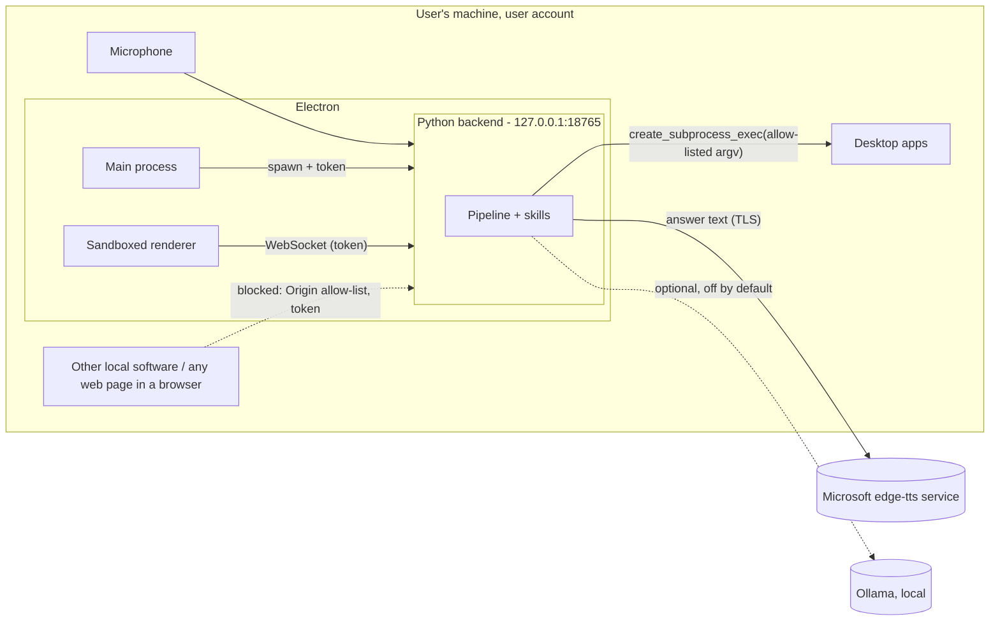

# Threat model

GIDEON listens to a microphone, runs commands on the user's desktop and exposes a WebSocket on the loopback
interface. This document lists what is worth protecting, who could attack it, and what the code does about it.
Method: assets → trust boundaries → STRIDE threats → mitigations, each with a pointer to code or a test.

## Assets

| Asset | Why it matters |
|---|---|
| A1 Microphone audio | Everything said near the computer. The most sensitive asset. |
| A2 Transcripts, notes, traces | Derived from A1. Notes may hold personal reminders. |
| A3 Ability to run programs | The `open app` skill starts processes as the user. |
| A4 The control channel (WebSocket) | Whoever controls it can trigger listening, typed commands and app launches. |
| A5 The renderer | An Electron renderer with Node access would be remote code execution waiting to happen. |

## Trust boundaries

What crosses each boundary:

- Audio never leaves the backend process. Transcription runs locally (faster-whisper). Wake-word audio is not
  stored.
- Only the answer text goes to the edge-tts service. The transcript does not.
- The renderer receives events and sends five command types. It has no other capability.

## Threats and mitigations (STRIDE)

| # | Threat | STRIDE | Mitigation | Where |
|---|---|---|---|---|
| T1 | A web page in the user's browser opens `ws://127.0.0.1:18765` (cross-site WebSocket hijacking) and sends `say "open ..."` | Spoofing, EoP | WebSockets are not covered by CORS, but browsers always send `Origin`. The server rejects any Origin outside an allow-list (`app://gideon`, the dev and compose UI origins) with HTTP 403 **before** the upgrade. | `GideonServer._check_origin`; `test_foreign_browser_origin_is_rejected_before_the_upgrade` |
| T2 | Another local process or user connects without an Origin header | Spoofing | Bound to `127.0.0.1` only (no LAN exposure). When Electron starts the backend it generates a 192-bit random token per launch and passes it through the environment; the client must present it in `hello` (constant-time comparison), otherwise close 4401. A process running as the same user can already read the microphone itself, so the socket gives it nothing more. | `main.cts`, `GideonServer._handshake`; `test_bad_token_closes_with_4401` |
| T3 | Malformed, oversized or flooding frames crash or stall the pipeline | DoS, Tampering | 64 KiB frame limit (close 1009). Every frame is validated against the pydantic schema with `extra="forbid"` and length limits (`say.text` ≤ 500). A bad frame gets an `error` reply and never raises in the pipeline. The hello must arrive within 5 s. | `server.py`, `protocol.py`; `test_invalid_frames_*`, `test_oversized_frames_*`, `test_rejects_bad_frames_*` |
| T4 | A misheard or malicious phrase ("open calc; rm -rf ~", "start cmd.exe /c del") runs arbitrary commands | EoP | The transcript only *selects* an allow-list key. argv comes from the allow-list (`calc.exe`, `gnome-calculator`, ...), never from text. Processes start with `create_subprocess_exec`, never a shell. Unknown names get a spoken refusal. `GIDEON_APPS_DRY_RUN=1` (the default in Docker) only reports what would run. | `OpenAppSkill`; `test_open_app_uses_the_allow_list_argv_and_never_the_transcript` |
| T5 | XSS in the renderer through a transcript or note ("") | Tampering, EoP | All server text is written with `textContent`. CSP is `default-src 'none'; script-src 'self'; style-src 'self'; connect-src ws://127.0.0.1:18765 …`, with no `unsafe-inline` or `unsafe-eval`. | `view.ts`; `view.test.ts` "writes untrusted text as text"; Playwright asserts the CSP |
| T6 | A renderer compromise escalates to the OS | EoP | `contextIsolation: true`, `sandbox: true`, `nodeIntegration: false`, `webviewTag: false`. The preload exposes one frozen config object (no `ipcRenderer`, no generic send). Navigation and `window.open` are blocked. Every permission request, the microphone included, is denied (capture happens in Python). Files are served from a custom `app://` scheme with a path-traversal guard, not `file://`. The CSP is also sent as a header. | `electron/main.cts`, `electron/preload.cts` |
| T7 | Eavesdropping: audio recorded or sent away without the user knowing | Information disclosure | Audio is processed in memory and never written to disk (traces hold timings and the transcript, not audio). STT is local. The README states what goes to edge-tts. The LLM fallback is off by default, and its default provider is a local Ollama. The UI shows the current state (*listening* = recording a command). | `pipeline.py`, `skills/llm.py`, README |
| T8 | Accidental activation (false accept) records a private conversation | Information disclosure | Wake threshold 0.5 (openWakeWord's default operating point), a 1.5 s refractory period, a 4 s no-speech timeout, an 8 s maximum utterance, and a clearly visible *listening* state. The false-accept rate on real background audio was **not** measured here (see Limitations). | `PipelineConfig`, `EndpointConfig` |
| T9 | Tampering with traces/notes on disk | Tampering, Repudiation | They are local user files in the user's data directory, protected by OS permissions like any other user document. They are not used for security decisions. | `config.py` (`%LOCALAPPDATA%\gideon`, `$XDG_DATA_HOME/gideon`) |
| T10 | Supply chain: a compromised model or package | Tampering | All Python and npm versions are pinned. Models come from the official openWakeWord releases and Systran's Hugging Face repos and are baked into the image at build time (`HF_HUB_OFFLINE=1` at runtime). CI runs `pip-audit` and `npm audit` on every push, and CodeQL scans Python, TypeScript and Actions. | `pyproject.toml`, `package-lock.json`, `Dockerfile`, `.github/` |
| T11 | Container breakout from the demo stack | EoP | Non-root UID 10001, read-only root filesystem, `cap_drop: ALL`, `no-new-privileges`, ports published on 127.0.0.1 only, apps in dry-run mode. | `docker-compose.yml`, `backend/Dockerfile` |

## Residual risks and non-goals

- No acoustic echo cancellation (ADR 0003): with loudspeakers, an answer that contains the wake phrase could
  re-trigger GIDEON.
- The packaged app is not code-signed and Electron fuses are not flipped (`runAsNode`, `nodeOptions`). These are the
  next hardening steps before distributing binaries.
- The browser-mode compose demo has no token, because a browser page cannot receive one from Electron's main
  process. It is protected by the Origin allow-list and loopback-only ports, and it runs in dry-run mode.
- Speaker identification is out of scope: anyone in the room can give commands, as with any smart speaker.
